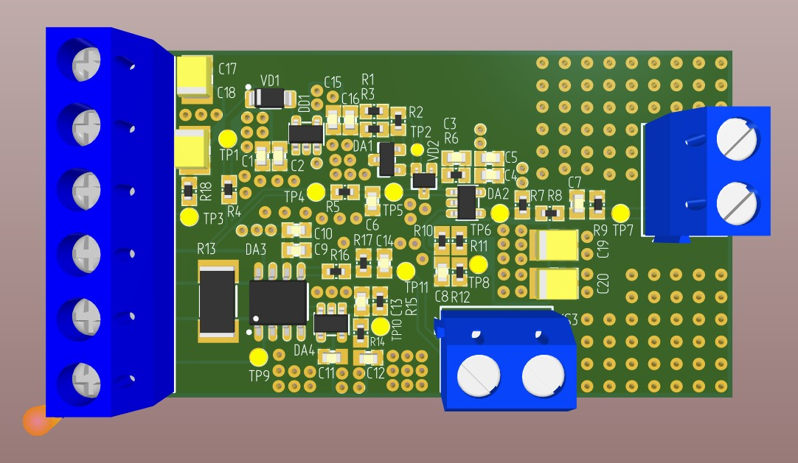

# Модуль цифрового входа

## 1. Описание

Устройство позволяет определять частоту и скважность входного сигнала, измерять длительность импульсов, считывать логическое состояние входа и измерять ток.

Обмен данными с модулем осуществляется через интерфейс **USB CDC**

## 2. Основные характеристики

| Параметр | Значение |
|---|---|
| Тип устройства | Модуль цифрового входа |
| Напряжение питания | 5 В |
| Интерфейс взаимодействия | USB CDC |
| Микроконтроллер управляющей платы | STM32F303CCT6 (BluePill) |

## 3. Подключение

### 3.1. Подключение к BluePill STM32F303CCT6

| Сигнал модуля | Вывод микроконтроллера | Назначение |
|---|---|---|
| `OUT` | `PA15` | Цифровой сигнал |
| `OUT_ADC` | `PA0` | Аналоговый сигнал для измерения тока |

## 4. Возможности модуля

#### 1) Измерение частоты сигнала

#### 2) Измерение скважности сигнала

#### 3) Измерение длительности импульса

#### 4) Измерение тока

#### 5) Считывание состояния входа

## 5. Интерфейс взаимодействия USB CDC

USB CDC (Communications Device Class) позволяет взаимодействовать с устройством через виртуальный последовательный порт.

Для управления модулем предусмотрен набор текстовых команд. Команды отправляются через терминальную программу или другое приложение, поддерживающее последовательный порт.

| Команда | Назначение |
|---|---|
| `get_freq` | Получение измеренной частоты сигнала, Гц |
| `get_duty` | Получение измеренной скважности или коэффициента заполнения, % |
| `get_current` | Получение измеренного значения тока, мА |
| `get_pin_state` | Получение текущего логического состояния входа, HIGH/LOW |
| `get_pulse` | Получение длительности импульса, мс |
| `set_config_measure_pulse` | Настройка параметров измерения длительности импульса |
| `set_config_measure_freq` | Настройка параметров измерения частоты |
| `get_config_measure` | Получение текущей конфигурации измерений |
| `help` | Вывод справки по доступным командам |

## 6. Аппаратная часть

Электрическая принципиальная схема устройства находится в файле:

[**Digit_input_Э3.pdf**](./Hardware/Digit_input_Э3.pdf)

## 7. Общий вид устройства
